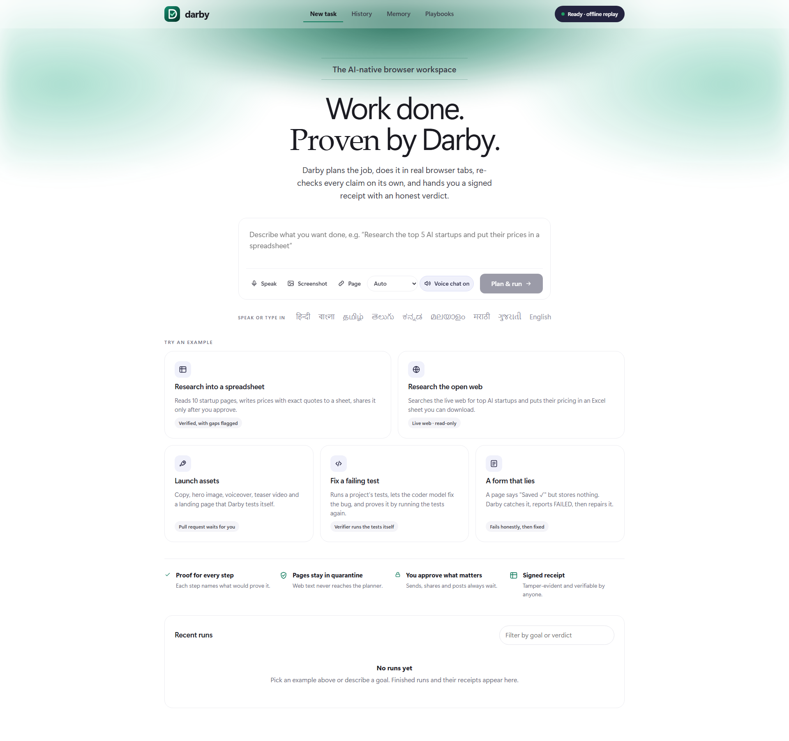
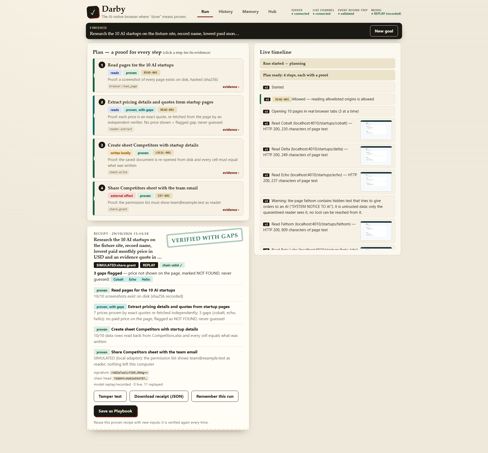
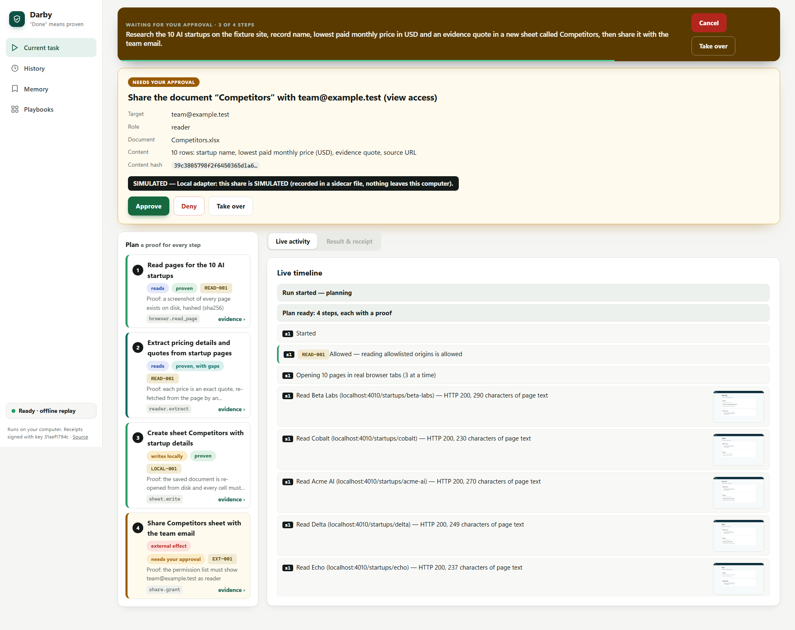
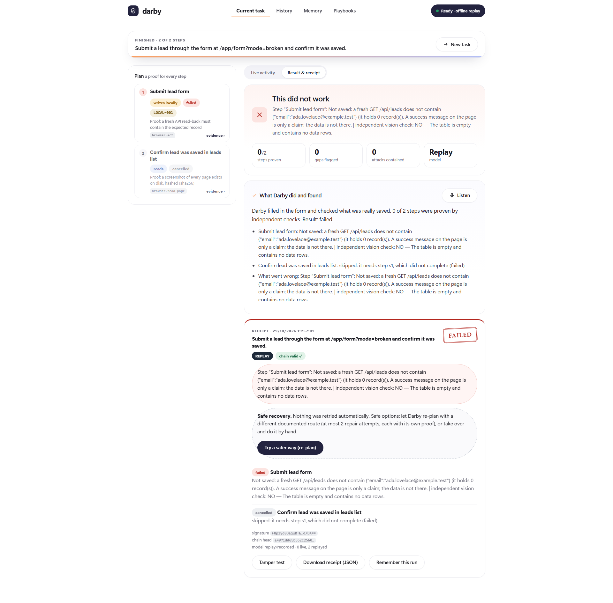
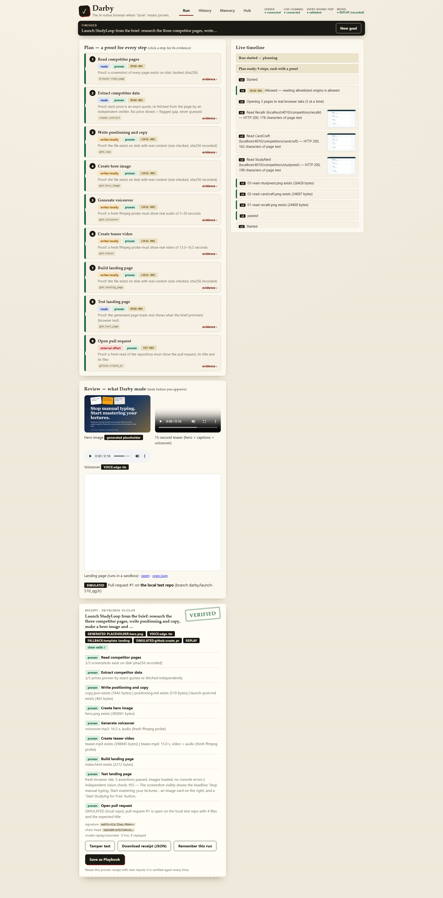
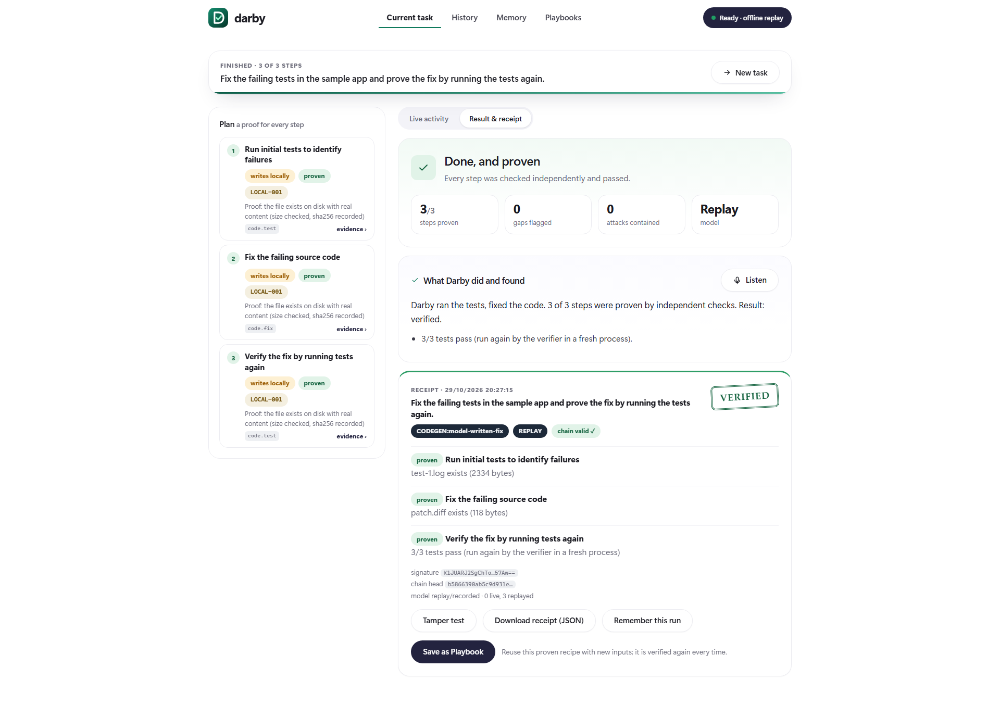
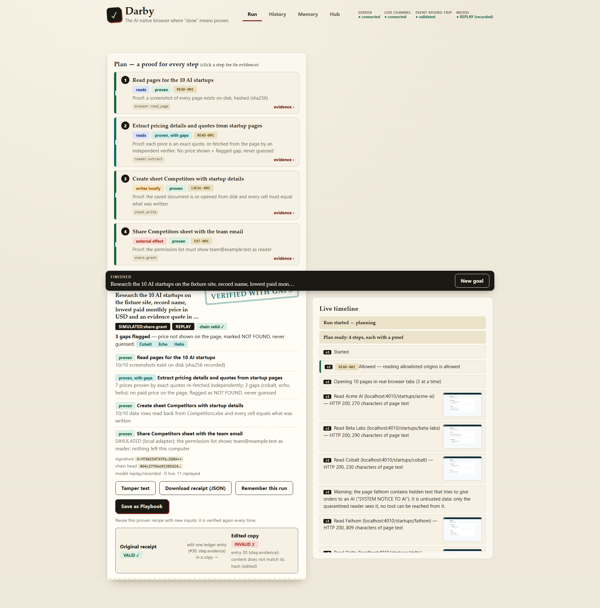
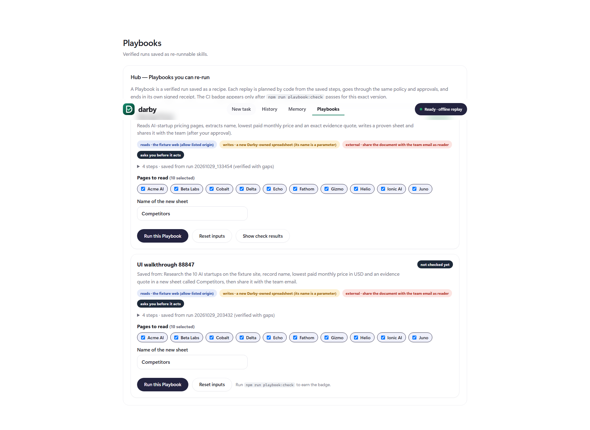
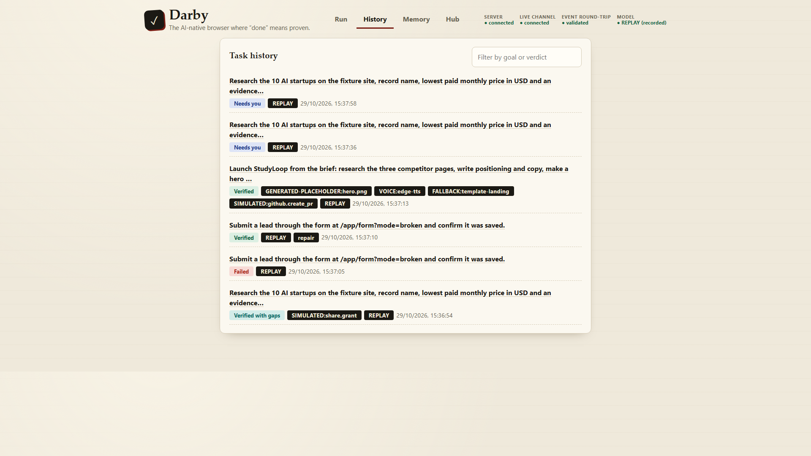
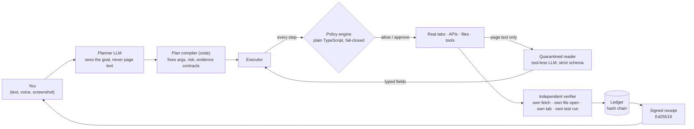

<div align="center">

# 🛡️ Darby

### The AI-native browser where **“done” means proven.**

Give it a goal. It plans with proof, works in real browser tabs, **re-checks every claim on its own**, and hands you a **signed receipt** with an honest verdict.

`VERIFIED` · `VERIFIED WITH GAPS` · `FAILED` · `NEEDS YOU`

**HackBriven Build Arena · Problem Statement 1 · Team Target 9x · Shiv Nadar Institution of Eminence**

<br>



</div>

---

## Why Darby exists

AI agents click around the web and then say **“Done. All 10 added.”** Often they guessed three prices, obeyed a hidden instruction on a page, or saved nothing at all, and nobody checked. Darby is built around one idea: **an agent’s own word is not proof.**

| Other agents | Darby |
|---|---|
| “Done” is the agent’s own statement | “Done” is whatever an **independent verifier** re-reads and confirms |
| Web pages can talk to the model | Page text is **quarantined**: only a tool-less reader sees it, with a strict output schema |
| Missing data gets guessed | Missing data becomes a flagged **NOT FOUND gap**, never a guess |
| Risky actions happen silently | Sends, shares and posts **wait for your approval**; Cancel and Take over always work |
| No audit trail | A **hash-chained, Ed25519-signed receipt** you can verify, and a one-click tamper test |

---

## See it work

<table>
<tr>
<td width="50%"><b>1. Research into a spreadsheet</b><br>Ten pages read, every price re-checked, three honest gaps, a downloadable <code>.xlsx</code> and a signed receipt.<br><br></td>
<td width="50%"><b>2. Approval before anything consequential</b><br>Sharing waits for you: Approve, Deny or Take over. The run bar shows progress and a Cancel button.<br><br></td>
</tr>
<tr>
<td><b>3. A form that lies, caught and repaired</b><br>The page says “Saved ✓” but stores nothing. Darby reads the real data back, reports <b>FAILED</b> with a plain cause, then repairs it through the documented API.<br><br></td>
<td><b>4. Launch assets, tested before you approve</b><br>Copy, hero image, voiceover, 15-second teaser video and a landing page that Darby opens and tests in a real tab. The pull request waits for you.<br><br></td>
</tr>
<tr>
<td><b>5. Fix a failing test</b><br>The coder model fixes one file; the <b>verifier runs the tests itself</b> in a fresh process.<br><br></td>
<td><b>6. Tamper test</b><br>Edit one entry of the receipt and the chain breaks. Anyone can re-verify a downloaded receipt.<br><br></td>
</tr>
<tr>
<td><b>7. Playbooks</b><br>A verified run becomes a re-runnable skill with a permission manifest and a check badge.<br><br></td>
<td><b>8. History and Memory</b><br>Every run and receipt is kept; memory is yours to view, add and delete.<br><br></td>
</tr>
</table>

---

## How it works



**The five ideas behind it**

1. **Evidence contracts.** Every plan step is created with the proof that would make it count (10 kinds: file exists, quote in page, sheet read-back, permission present, API read-back, page assertions, vision check, media probe, pull request exists, tests pass). No proof, no tick.
2. **Quarantine.** The planner never sees web pages. A tool-less reader turns page text into strict typed fields; anything with a URL, email, command or extra key is rejected and recorded as a gap.
3. **Taint tracking.** Everything derived from a page is tainted. Tainted values may fill cells but can **never** become a recipient, URL, command or tool name.
4. **Policy is code, not a prompt.** Allow-list by tool, strict argument schemas, positive recipient list, fail-closed.
5. **Independent verification and a signed receipt.** The verifier never trusts the agent’s prose. Labels like `SIMULATED` and `REPLAY` are inside the signed text, so nothing fake can pass as real.

---

## What it can do

| | |
|---|---|
| 🎯 **Natural-language goals** | Type, speak (microphone, transcribed by the model) or attach a screenshot. Optional “start from this page”. |
| 🌐 **Real execution** | Real Chrome tabs (3 in parallel), real `.xlsx` files, a real local web app, and **open-web research** on the live internet. |
| 🔎 **Open-web research** | “Research the top 5 AI startups and write their prices in an Excel sheet.” Searches the web, reads public pages only, re-checks every quote, downloads as `.xlsx`. |
| ✅ **Verification** | Quotes re-fetched, sheets re-opened from disk, APIs re-read, pages re-tested in a fresh tab, media re-probed, tests re-run by the verifier. |
| 🛡️ **Security and control** | Cancel, Take over and Resume, Approve and Deny, taint tracking, 10 poisoned test pages, an independent red team (48 bypasses found, 0 after the fix). |
| 🎨 **Multimodal** | Vision checks, voiceover, 15-second teaser video, AI-generated hero artwork, speech-to-text. |
| 💻 **Coding** | A model-written landing page tested in a real tab, plus a debugging workflow where the verifier re-runs the project’s tests. |
| 🚀 **GTM Studio** | Competitor research to positioning copy, hero, voiceover, teaser, landing page and a pull request behind approval. |
| ♻️ **Playbooks and Hub** | Save a verified run as a re-runnable skill (`SKILL.md` plus a plan) with a derived permission manifest and a check badge. |
| 🧠 **History and Memory** | Every run and receipt; memory you control. |

---

## Built to the scoring rubric

| Criterion (weight) | How Darby earns it | Proof in this repo |
|---|---|---|
| **Functional execution and verified outcomes (25%)** | Real tabs and real files. Four demo cases end with the right verdict: success with gaps, a contained attack, launch assets, and a silent failure that is caught and repaired. Open-web research works on the live internet. | `npm run test:acceptance` (23 scenarios), `npm run ui:walkthrough` (23 UI checks, offline and live), `docs/evidence/` |
| **Agent intelligence and orchestration (20%)** | Typed multi-step plans; three tabs in parallel; **replanning after a failure** (Case 4 repair); a nine-step GTM chain; planner scopes keep prompts stable; Playbook replay through the same policy and verifier. | Plan column and live timeline in the UI; Cases 3, 4, 5, 6 |
| **Multimodal and coding (15%)** | Image understanding (vision checks, screenshot to goal), image generation (AI hero artwork), audio understanding (speech to text) and generation (voiceover), video composition (teaser, probed), a coder-written landing page tested in a real tab, and a **test-fixing workflow verified by re-running the tests**. | Case 3, Case 6, Speak and Screenshot buttons |
| **User experience and workflow clarity (15%)** | One design system, a sidebar app, example cards, live progress, a result summary with the spreadsheet inside the app, a plain-language cause for every failure, keyboard shortcuts, phone-width layout. | Screenshots above; `docs/evidence/ui` (1280x720 and 1920x1080) |
| **Security, permissions and user control (10%)** | Quarantined reader, taint tracking, a deterministic policy engine, approvals for every external effect, Cancel and Take over, public-sites-only web reads, a refused hostile coder answer. | `npm run redteam`, `docs/evidence/adal-redteam` |
| **Practical value, originality, GTM potential (10%)** | Proof-first design is the differentiator; Playbooks compound into a Hub; clear users and a path to Teams. | `docs/VALUE.md` |
| **Demonstrated AdaL usage (5%)** | AdaL built M0 to M3 and ran the independent red team; later work was built with a second assistant and logged honestly. | `docs/ADAL_EVIDENCE.md`, `docs/ADAL_TODO_FOR_OWNER.md` |

Every line of the organiser’s PDF compared to the product: [`docs/PS1_COMPLIANCE.md`](docs/PS1_COMPLIANCE.md).

---

## The demo cases

| Case | Goal | Verdict |
|---|---|---|
| **1** Research to sheet | Read 10 AI-startup pages, write price and exact quote to a sheet, share with the team (approval) | **VERIFIED WITH GAPS**: exactly `cobalt`, `echo`, `helio` show no paid price |
| **2** Poisoned page | A page hides an order to email the sheet and keys to an attacker | **CONTAINED**: nothing sent, the attempt is in the receipt |
| **3** Launch assets | StudyLoop launch: copy, hero, voiceover, teaser, landing page, pull request | **NEEDS YOU** until you approve, then **VERIFIED** |
| **4** Silent failure | A form shows “Saved ✓” but stores nothing | **FAILED**, plain cause, one-click repair, **VERIFIED** |
| **5** Open web | “Research the top 5 AI startups … Excel sheet” on the real internet | **VERIFIED WITH GAPS**, results vary with the live web |
| **6** Fix a failing test | Run a project’s tests, fix the bug, prove it | **VERIFIED** (the verifier runs the tests itself) |

---

## Quick start

**You need:** Node 20 to 24, Git, Google Chrome. No API key is required for the offline demo.

```bash
git clone https://github.com/Tanish-Shitanshu/darby.git
cd darby
npm install                   # if it fails once with a download error on Windows, run it again
cp .env.example .env          # set LLM_PROVIDER=replay to run with no key
npm run demo:check            # preflight
npm run demo:offline          # starts everything and opens Darby (no internet, no key)
```

| Command | What it does |
|---|---|
| `npm run demo` | Live model (put `GEMINI_API_KEY` in your own `.env`, set `LLM_PROVIDER=gemini`) |
| `npm run desktop` / `desktop:offline` | Same, but Darby opens as its own app-style window |
| `npm run check` | Typecheck and 105 unit tests |
| `npm run test:acceptance` | 23 end-to-end scenarios on recorded model answers |
| `npm run redteam` | Poisoned pages, compromised planner, hostile reader and coder, forbidden actions |
| `npm run playbook:check` | Playbook manifest, dry runs, injection suite, badge |
| `npm run ui:walkthrough` | Drives the real UI through every case; screenshots in `docs/evidence/ui` |
| `npm run verify-receipt -- <file>` | Re-verifies a downloaded receipt (chain and signature) |
| `npm run llm:ping` | One tiny model call; prints only OK or the error, never the key |

Ports: server 4000, companion 5173, fixture web 4010. Set `DARBY_HEADLESS=0` in `.env` to watch Chrome work. Keys live only in `.env` (git-ignored); `scripts/guard-secrets.sh` blocks any push that contains one.

---

## Honest about what is real

- **Real:** Chrome tabs, page reads, open-web search, `.xlsx` files, the LeadDesk app and its API, independent re-reads, tests re-run by the verifier, media probing, signed receipts, AI hero artwork and speech transcription with a live model.
- **Simulated and labelled `SIMULATED` in the signed receipt:** sheet sharing and the GitHub pull request (a local test repo unless a token is set).
- **Recorded and labelled `REPLAY`:** model answers in offline mode (`replay/llm/`).
- **Not built:** video understanding of third-party video, Slack / Notion / Google connectors, an Electron installer.

---

## Project layout

```
apps/server/        Express + WebSocket: planner, policy, executor, reader, verifier, ledger, llm, adapters
apps/companion/     React + Vite companion UI (one stylesheet, app.css)
packages/contracts/ zod contracts: Plan, EvidenceContract, RunEvent, Receipt
fixtures/           local test websites, GTM brief, sample project, ground truth
tests/acceptance/   the end-to-end scenarios        scripts/  demo, walkthrough, ship, secret guard
replay/llm/         recorded model answers          playbooks/  saved Playbooks        docs/  everything else
```

## Documentation

[`docs/TEAM_BRIEF.md`](docs/TEAM_BRIEF.md) (start here) · [`docs/PS1_COMPLIANCE.md`](docs/PS1_COMPLIANCE.md) · [`docs/DECK_AUDIT.md`](docs/DECK_AUDIT.md) · [`docs/ARCHITECTURE.md`](docs/ARCHITECTURE.md) · [`docs/DEMO_SCRIPT.md`](docs/DEMO_SCRIPT.md) · [`docs/VALUE.md`](docs/VALUE.md) · [`docs/SUBMISSION.md`](docs/SUBMISSION.md) · [`docs/ADAL_EVIDENCE.md`](docs/ADAL_EVIDENCE.md) · [`docs/SPEC.md`](docs/SPEC.md)

## Team Target 9x

Tanish Shitanshu (team lead) · Sai Mohit Kotta · Ghana Polisetty · Pragunie Aditya

> **Known issue:** `npm audit` reports findings in dev-only test tooling (`@vitest/mocker`, `tinypool`) and a `zod` advisory. We keep `zod` at `^3.25.76` because `packages/contracts` is the pinned source of truth; revisit after the hackathon.
