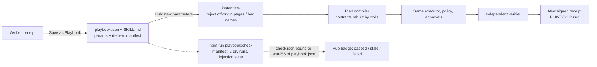
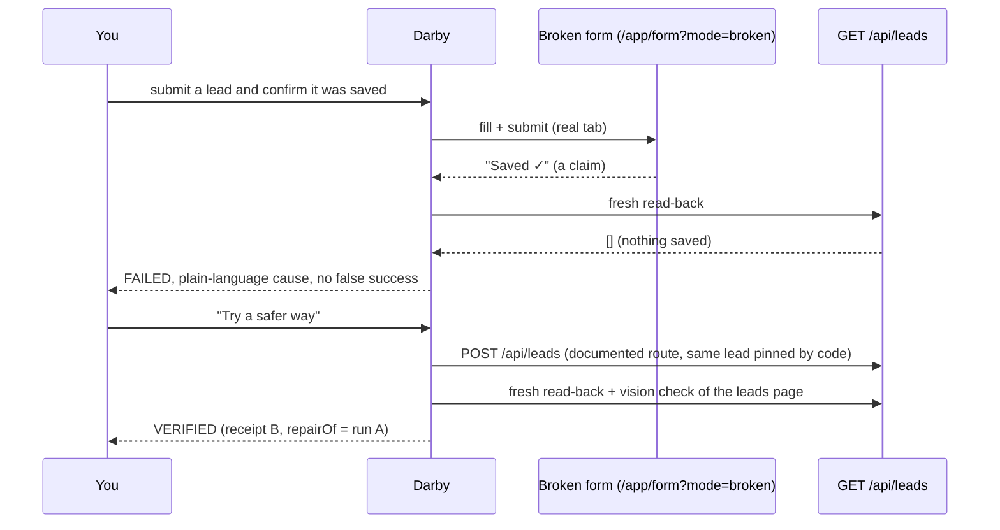

# Darby architecture

Darby is a companion inside a real browser. A goal becomes a plan; every step carries an **evidence contract** (what would prove it); a deterministic **policy engine** (plain code) decides what may run; page text only ever reaches a **quarantined, tool-less reader**; an **independent verifier** checks each claim with its own fresh read; the run ends in a **hash-chained, Ed25519-signed receipt**.

```mermaid
flowchart LR
  U([You]) -->|goal| C[Companion UI<br/>React/Vite]
  C <-->|REST + WebSocket RunEvents| S[Server<br/>Express + ws]
  S --> P[Planner<br/>goal -> typed Plan<br/>sees NO page text]
  P --> K[Plan compiler<br/>code fixes args, risk,<br/>evidence contract per step]
  K --> E[Executor]
  E --> POL{{Policy engine<br/>READ-001 LOCAL-001 EXT-001<br/>TAINT-002 FORB-003}}
  POL -->|allow| T[Tools]
  POL -->|external effect| A[[Approval card<br/>Approve / Deny / Take over]]
  A -->|approved| T
  POL -->|block| L
  T --> B[Real Chromium tabs]
  T --> R[Quarantined reader<br/>tool-less, strict schema]
  T --> G[GTM tools<br/>copy, hero, voice, teaser,<br/>landing page, PR]
  B -->|page text = untrusted| R
  R -->|tainted, validated records| E
  E --> V[Independent verifier<br/>fresh fetch / file open /<br/>fresh browser tab / ffmpeg probe /<br/>vision model / repo read-back]
  V -->|pass / gap / fail| E
  E --> L[(SQLite ledger<br/>hash chain)]
  L --> RC[Signed receipt<br/>VERIFIED | WITH_GAPS | FAILED | NEEDS_YOU]
  RC --> C
```

## Trust boundaries (what makes "proven" mean something)
| Boundary | Rule |
|---|---|
| Planner | Sees the goal, trusted Sources and config only. Never page text. Proposes; code (the plan compiler) fixes arguments, URLs, risk tier and the evidence contract. |
| Page text | Untrusted. Goes only to the reader (no tools, no memory, no goal). Its output must validate against a strict schema and is rejected if it contains URLs, emails, commands or extra keys. Everything derived from it is **tainted**. |
| Policy | Allow-list by tool, strict argument schemas, canonicalisation, domain-level taint, positive recipient list; fails closed. Hardened against an independent headless-AdaL red team (48 bypasses found, 0 after the fix: `docs/evidence/m2-review.md`). |
| External effects | Share, email, pull request: always an approval card showing target, content summary and a content hash. Denied or cancelled = nothing happens, verdict NEEDS_YOU. |
| Verifier | Never imports the executor and never sees the agent's prose. Own fetch, own file open, own browser tab, own ffmpeg run, own repo read, own vision call (one screenshot, one yes/no question). A page that says "Saved ✓" is a claim; the data is checked. Could not verify = NEEDS_YOU, never VERIFIED. |
| Receipt | Every event is appended to a SQLite ledger with `hash = sha256(prev + canonicalJson(entry))`; the run's receipt is signed (Ed25519). `npm run verify-receipt` and the UI's tamper test recompute both. Labels (`SIMULATED`, `REPLAY`, `FALLBACK:…`, `PLACEHOLDER:…`) are part of the signed text. |

## Evidence contracts
`quote_in_page` · `sheet_readback` · `permission_present` · `http_json_contains` · `page_assertions` · `file_exists` · `vision_check` · `media_probe` · `pr_exists` (`packages/contracts`).

## Playbooks (M7)
A verified run can be saved as `playbooks/<slug>/{playbook.json, SKILL.md}`. Only the plan is stored (steps, portable URLs, two parameters, a permission manifest derived from the steps); never a contract, verdict or permission. A replay rebuilds the plan through the same plan compiler and runs the same engine, so policy, approvals, taint and the independent verifier apply again and the run gets its own signed receipt labelled `PLAYBOOK:<slug>`.



## A failed run and its repair (Case 4)


## Models and fallbacks
Gemini free tier (planner, reader, creative copy, coder, vision) behind a rate limiter and a replay store: every response is cached; `LLM_PROVIDER=replay` answers only from recordings (offline demo, labelled REPLAY). Launch assets: hero = deterministic rendered card (labelled placeholder), voiceover = edge-tts / macOS `say` / espeak-ng / labelled placeholder tone, teaser = ffmpeg, landing page = coder model with a browser test-and-repair loop, else labelled template, PR = real GitHub test repo with a token, else a local simulated repo (labelled).
